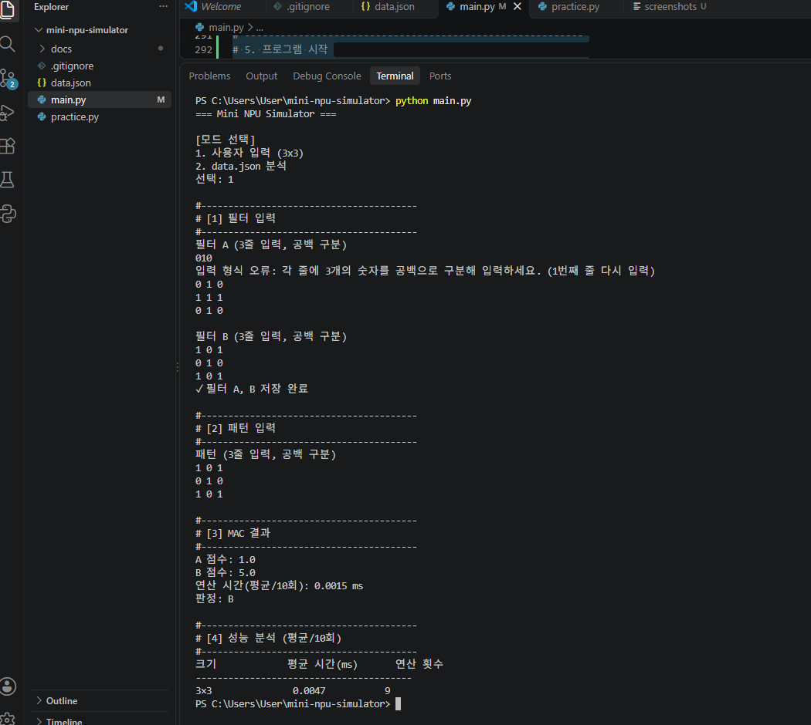
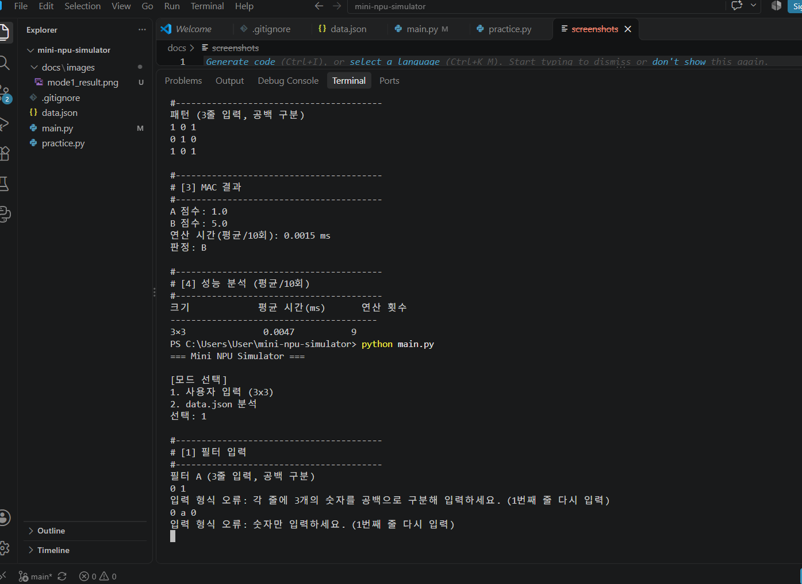
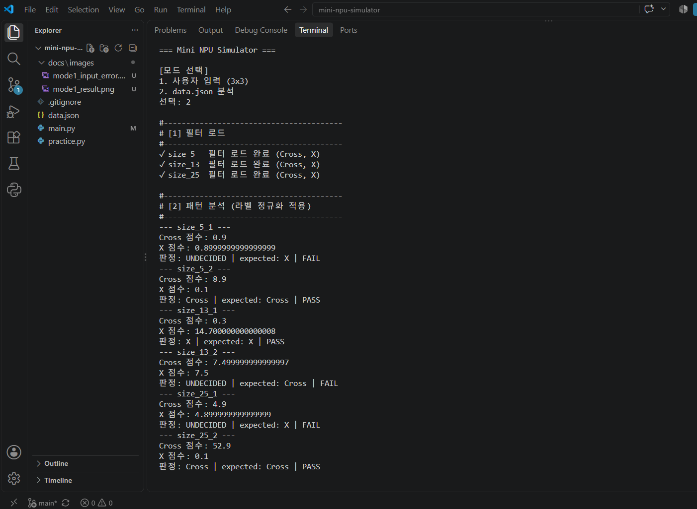
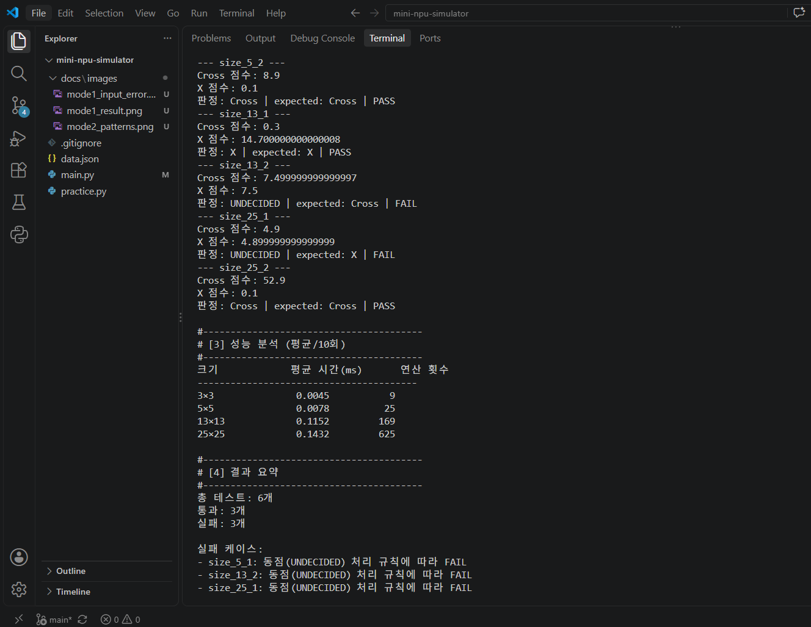

# Mini NPU Simulator

MAC(Multiply-Accumulate) 연산으로 입력 패턴이 십자가(Cross)인지 X인지 판정하는 Python 콘솔 프로그램입니다.

---

## 실행 방법
- Python 3.8 이상 (외부 라이브러리 없음, 표준 라이브러리 `json`, `time`만 사용)
- `data.json`을 `main.py`와 같은 폴더에 둔다
- 실행: `python main.py`
- 모드 선택
  - `1` : 사용자 입력 (3×3 필터 A, B와 패턴을 콘솔로 입력)
  - `2` : data.json 분석 (5×5, 13×13, 25×25 일괄 판정)

---

## 구현 요약

### MAC 연산
- 패턴과 필터의 같은 위치 값을 곱해 모두 더한다.
- NumPy 없이 이중 `for`문으로 직접 구현했다. (`mac()` 함수)

### 라벨 정규화
- 프로그램 내부에서는 표준 라벨 `Cross`, `X` 두 가지만 사용한다.
- 입력값을 공백 제거 + 소문자 변환한 뒤 변환표로 바꾼다.
  - expected: `+` → Cross, `x` → X
  - filter 키: `cross` → Cross, `x` → X
- 콘솔 출력과 PASS/FAIL 비교는 모두 표준 라벨 기준으로 한다.

### 동점 처리 정책 (epsilon)
- `abs(score_a - score_b) < 1e-9` 이면 동점으로 보고 `UNDECIDED`(판정 불가) 처리한다.
- 실수 계산은 미세한 오차가 생기므로 `==` 비교 대신 허용오차 비교를 사용했다.

### 입력 검증 및 예외 처리
- 모드 1: 한 줄의 숫자 개수가 3개가 아니거나 숫자가 아니면 안내 문구를 출력하고 그 줄을 다시 입력받는다.
- 모드 2: 키 형식 오류, 필터 없음, 패턴 크기 불일치, 알 수 없는 라벨은 해당 케이스만 FAIL로 처리하고 다음 케이스를 계속 진행한다. (프로그램이 중단되지 않음)

### 패턴 생성기 (보너스)
- `make_cross(n)`, `make_x(n)`으로 N×N 십자가/X 패턴을 자동 생성해 성능 분석에 사용했다.

---

## 실행 화면

### 모드 1: 사용자 입력

### 모드 1: 입력 오류 시 재입력

### 모드 2: data.json 분석

---

## 결과 리포트

### 1. 테스트 결과
- 총 6개 / 통과 3개 / 실패 3개

| 케이스 | Cross 점수 | X 점수 | 판정 | expected | 결과 |
|---|---|---|---|---|---|
| size_5_1 | 0.9 | 0.8999999999999999 | UNDECIDED | X | FAIL |
| size_5_2 | 8.9 | 0.1 | Cross | Cross | PASS |
| size_13_1 | 0.3 | 14.700000000000008 | X | X | PASS |
| size_13_2 | 7.499999999999997 | 7.5 | UNDECIDED | Cross | FAIL |
| size_25_1 | 4.9 | 4.899999999999999 | UNDECIDED | X | FAIL |
| size_25_2 | 52.9 | 0.1 | Cross | Cross | PASS |

### 2. 실패 원인 분석
- 실패 3건은 모두 **수치 비교 문제**이며, 데이터/스키마 문제나 로직 문제는 아니다.
- **데이터/스키마 측면:** 모든 필터와 패턴이 키의 N과 크기가 일치했고, 라벨(`+`, `x`, `cross`)은 정규화로 모두 표준 라벨로 변환되어 표기 차이로 인한 FAIL은 없었다.
- **로직 측면:** 점수 차이가 분명한 3건(size_5_2, size_13_1, size_25_2)은 모두 expected와 같게 판정되어 MAC 연산과 판정 로직이 정상임을 확인했다.
- **수치 비교 측면:** 실패한 3건은 필터의 특정 칸에 조정된 값(0.9, 7.5, 4.9 등)이 들어 있어 Cross 점수와 X 점수가 사실상 같아지도록 구성되어 있었다.
  - size_5_1: Cross 필터 중앙값 0.9 → Cross 점수 0.9, X 점수는 0.1 × 9칸 = 0.8999999999999999
  - size_13_2: X 필터 중앙값 7.5 → X 점수 7.5, Cross 점수는 0.3 × 25칸 = 7.499999999999997
  - size_25_1: Cross 필터 중앙값 4.9 → Cross 점수 4.9, X 점수는 0.1 × 49칸 = 4.899999999999999
- 두 점수의 차이는 약 1e-16 수준으로, 수학적으로는 같은 값인데 부동소수점 오차 때문에 끝자리만 다르게 계산되었다.
- `==`로 비교했다면 오차 방향에 따라 우연히 Cross 또는 X가 선택되어 신뢰할 수 없는 판정이 나왔을 것이다.
- epsilon(1e-9) 정책에 따라 이 경우를 동점(UNDECIDED)으로 처리했고, 판정이 expected와 다르므로 규칙대로 FAIL로 기록했다.
- 즉 이 FAIL은 프로그램 오류가 아니라 "동점은 판정하지 않는다"는 비교 정책이 의도대로 동작한 결과다.

### 3. 시간 복잡도 분석

| 크기 | 평균 시간(ms, 10회) | 연산 횟수(N²) |
|---|---|---|
| 3×3 | 0.0045 | 9 |
| 5×5 | 0.0078 | 25 |
| 13×13 | 0.1152 | 169 |
| 25×25 | 0.1432 | 625 |

- MAC 연산은 N×N 배열의 모든 칸을 한 번씩 곱하고 더하므로 연산 횟수는 N²이다. 따라서 시간 복잡도는 **O(N²)**이다.
- 5×5 → 25×25로 N이 5배 커지면 연산 횟수는 25배(25 → 625)가 된다.
- 측정 시간도 5×5의 0.0078ms에서 25×25의 0.1432ms로 약 18배 늘어나, 연산 횟수(25배)와 비슷하게 증가하는 경향을 보였다.
- 비율이 정확히 25배가 아닌 이유는 크기가 작을 때 함수 호출과 반복문 준비 같은 고정 비용의 비중이 크기 때문이다.
- 13×13(0.1152ms)이 예상보다 크게 나온 것은 0.1ms 수준의 아주 짧은 시간을 재기 때문에 운영체제의 다른 작업 등 외부 요인에 의한 측정 오차가 섞인 것으로 보인다. 실행할 때마다 값이 조금씩 달라진다.
- 시간 측정은 입력/출력 시간을 제외하고 `mac()` 호출 구간만 `time.perf_counter()`로 10회 반복 측정해 평균을 냈다.
- 실제 AI 모델은 이런 MAC 연산을 수억 번 수행하므로 순차 처리하는 CPU로는 느리고, 여러 MAC을 동시에 처리하는 NPU 같은 전용 하드웨어가 필요하다.